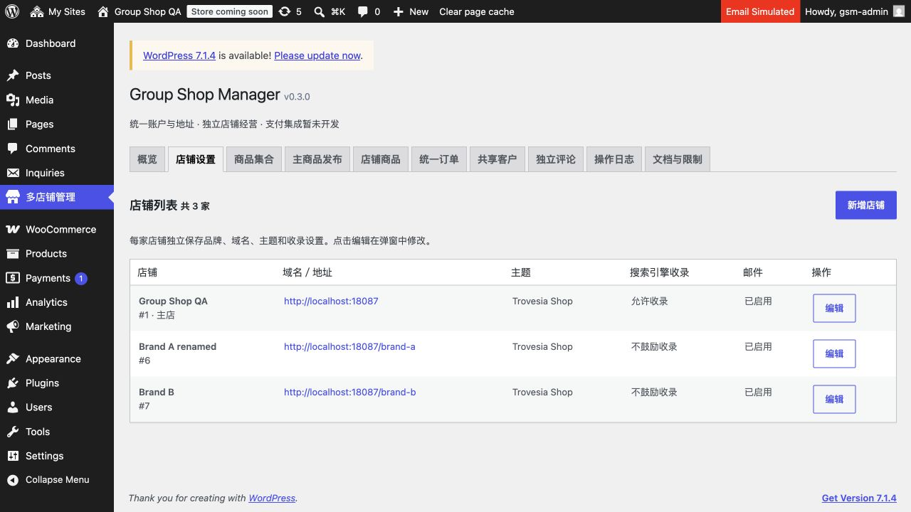

# 0.3.0 本地验收

日期：2026-11-03，Asia/Taipei。**本轮仅本地，不发布线上；等用户全部修改完成后明确通知。**

已移除统一分类/店铺分类菜单、原写接口、模板同步及继承/覆盖代码。分类/标签使用所属店原生 WooCommerce；商品发布不再复制或覆盖归属。商品集合保留，条件使用本店实际分类树和标签。

旧分类功能未建独立业务表。升级先把旧集合来源编号转换成本店编号，再清除三个模板/覆盖 termmeta；未能唯一对应的规则停用并标注待修正。保留原生分类、附件、商品归属、SEO 元数据以及商品发布映射/审计两张网络表。清理只在本机合成数据执行。

## 验证

共 **224 项**自动检查通过，另有浏览器验收：

- [基础、原生分类、集合与迁移：128 项](qa-report-v030.json)。包含本店层级、原生修改/删除联动、缺失条件保护、元数据清理、重试、权限、上下文恢复以及用户/商品/订单/无限库存回归。
- [Logo/收录：19 项](qa-store-settings-v030.json)。
- [店铺列表/域名：40 项](qa-store-list-v030.json)。
- [前台原生归档、导航、Store API 与分页：6 项](qa-http-v030.json)。
- [已登录真实 HTTP：24 项](qa-admin-http-v030.json)。十个页面、原生分类入口、真实 admin-post 集合保存、旧四个写接口拒绝、分类记录保留、旧 URL 安全回退，成功会话注销。
- [最终数据与表状态：7 项](qa-category-state-v030.json)。三店旧元数据均为零，集合均使用本店范围；仅保留 gsm_audit/gsm_catalog，无独立分类表。
- 浏览器：从集合页进入 /brand-a/ 所属店原生产品分类，真实新增 QA Browser Native Category；返回集合后立刻出现可选项。界面显示 0.3.0、十个菜单，两个分类菜单已删除。集合实际保存由上述 HTTP POST 验收，不以 CLI 渲染替代 HTTP。
- 14 个插件 PHP 文件、管理 JS、QA shell/Python 语法通过。修正原生删除使用 delete_term 钩子；原生父级编辑使用 saved_term，重算失败会 dirty/有限重试。

## 环境与接手

本机 Docker Desktop context desktop-linux，独立 project group-shop-manager-qa；127.0.0.1:18087、独立数据库与卷。QA 目录 /private/tmp/group-shop-manager-qa，代码链接当前工作区。没有导入生产数据；官方版本固定的插件包通过 HTTPS 下载后本地安装，邮件/支付均由 QA MU 拦截。凭据在该 QA 私有文件中，不随报告交付。

本地环境保留运行供用户查看：[店铺设置](http://localhost:18087/wp-admin/admin.php?page=group-shop-manager&tab=stores)。临时目录可能被系统清理；重建方法见插件 OPERATIONS。不要将 QA MU 挂到生产。

上一项 0.2.2 在新要求到达前已执行部署；本轮只读确认线上 0.2.2、四容器健康、部署标记清除。**没有向生产或远端 QA 同步本轮 0.3.0，也没有执行线上分类清理。** 不把旧版代码上线混同于本轮分类改动上线。

源码/数据边界、非活动店重新启用后的补迁移、未来备份/回滚说明见插件 HANDOFF、ARCHITECTURE、OPERATIONS。当前不执行任何未来发布步骤。
