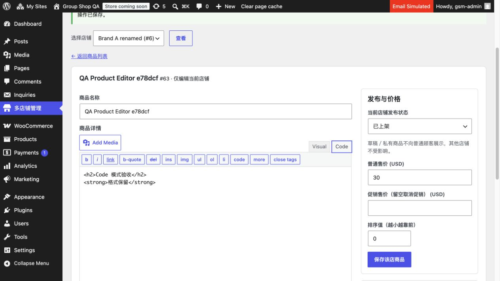

# 0.3.1 本地验收

日期：2026-11-03，Asia/Taipei。仅本地，未上传远端 QA／生产，未执行线上迁移或发布。线上仍按前次交接记录为 0.2.2，本轮未连接线上。

## 本轮结果

店铺商品列表增加主图，移除库存列，提供仅当前店的草稿禁用／上架。编辑使用原生富文本、当前店媒体选择、主图相册排序；变体同页按规格编辑，20 个一页，支持本页批量填价、启用／禁用、图片／描述。输入整批预校验、父子校验、完整表单检测和错误保留通过。

按用户在本轮的明确澄清，共享分类／标签改为主站原生产品后台唯一权威，全站受控投影。原“统一分类”“店铺分类”自建界面保持删除。旧独立分类决定已被覆盖。保留各店商品内容／价格／发布状态和集合独立，关联版本分类归属遵循主商品。

## 自动验收：147 项通过

- [商品编辑 34 项](product-editor.json)：原生状态跨店隔离、旧状态保护、分类写入拒绝、富文本净化、图片、变体价格／图片／启用、整批拒绝、伪造父级、上下文恢复、20 个分页、定时商品快捷上架、客户权限及无限库存。
- [统一分类 29 项](shared-taxonomies.json)：原生全店词表、父级／排序／封面投影与图片复用、映射商品归属、改名保 ID、分店权限及创建拒绝、主商品关系同步／移除、分店归属防覆盖、幂等、删除保护、集合保留、旧独有词条汇集保 ID、新店词表与默认分类一致。
- [真实 HTTP 25 项](http.json)：真实 admin-post 禁用／恢复，公共 Store API 隐藏且主／其他店仍公开；编辑器控件、截断拒绝、富文本保存、错误保留／修正、变体保存；原生目标店媒体查询／插图／无效授权；原生分类新增 AJAX／编辑表单全店同步，临时登录会话注销。
- [Logo／收录 19 项回归](store-settings.json)。
- [店铺列表／域名 40 项回归](store-list.json)。

20 个 PHP 文件（16 插件、4 个相关测试）语法通过；管理 JS 与 HTTP 验收 Python 语法通过。旧 integration.php 限定 0.3.0，当前用 prepare-local.php + 新套件，避免旧独立分类预期和重建站点影响现有本地浏览。

## 浏览器验收

- 原生媒体弹窗只列当前店图片；选择主图、同页批量填普通价／促销价，真实保存后重新读取成功，已禁用变体保留状态。
- 原生富文本插图最初发现 wp.media.post 别名未带店铺上下文，会把相同编号解析为主站附件。现已为 media.post、media.ajax 和富文本直连路径注入授权，允许对应原生 handler；实测图片 src 为 /wp-content/uploads/sites/6/...，不再引用主站同编号图片。HTTP 同时验收处理器返回内容。
- 用户指出 Code 工具栏按钮整行堆叠。根因是商品名称宽度选择器作用到所有后代 input；收窄为直接 regular-text 子输入。详情及短描述 Quicktags 工具栏恢复原生横排（695px 工具栏，首几个按钮约 22–65px，高度 37px）。
- 实测 Code 输入 HTML → Visual 显示标题／粗体 → Code → 保存，重新读取仍有对应内容。未刷新用户正在编辑的页面；单独测试页验证。

[商品主图列表与快捷操作截图](product-list.jpg)

## 环境和限制

Docker Desktop context desktop-linux，独立 group-shop-manager-qa、127.0.0.1:18087、独立数据库／卷。私有 QA 路径 /private/tmp/group-shop-manager-qa，不导入生产数据；qa-mail-guard 阻止真实邮件和支付，保留媒体初始化守卫。凭据与 Cookie 不在报告中。

统一分类是一个权威词表，WordPress Multisite 的原生 term／关系表仍须按店保存投影，不能共享表前缀或复用原始数字 ID。首次迁移汇集独有普通词条，同 slug 以主站为准，默认分类归一；集合单独保留，slug 冲突会报错并待修正。失败同步下次网络管理员请求重试；不宣称跨店数据库事务。第三方低层直写不是支持的编辑路径。源码回退不能恢复词表合并，需完整匹配备份；本轮未进行线上操作。
