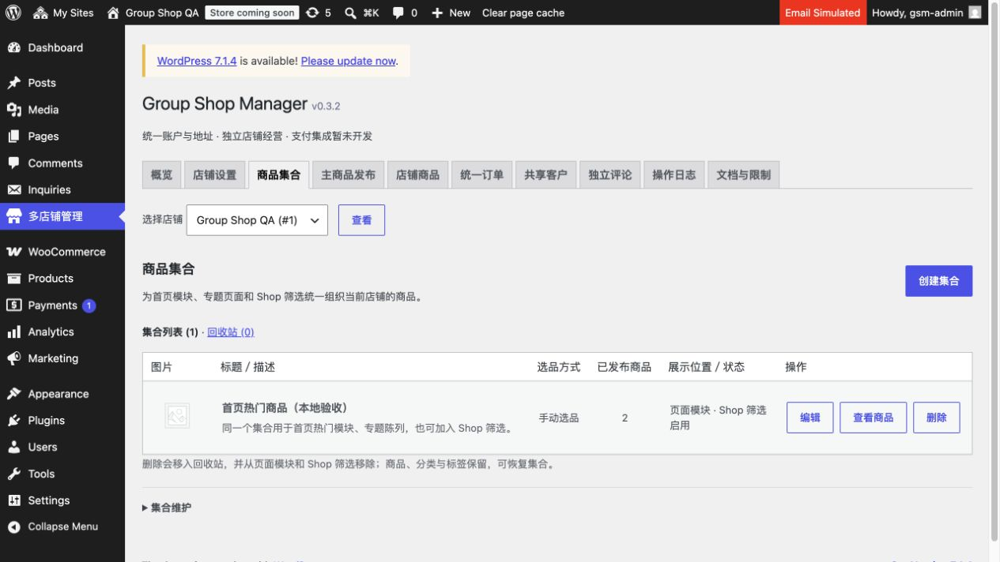
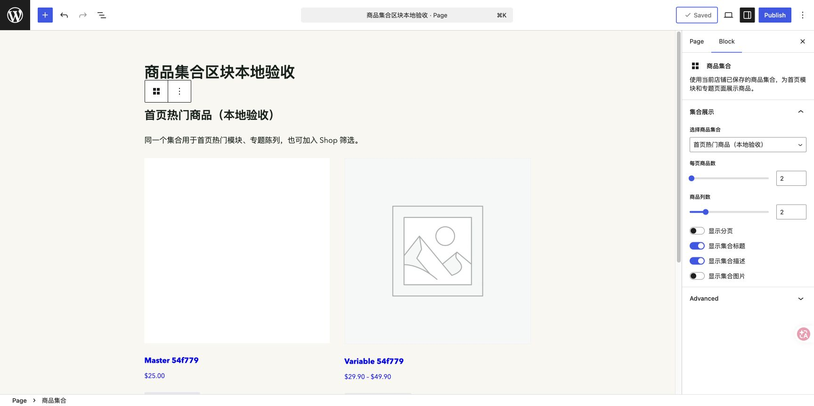

# 0.3.2 集合本地验收

完成日期：2026-11-04，Asia/Taipei。仅本机 localhost:18087 的隔离合成 QA。未连接生产、上传远端 QA 或部署；线上状态仍沿用先前 0.2.2 记录。

## 完成内容

商品集合为主要持久选品单元，按店保存：列表入口，独立创建／编辑页，标题／描述／本店媒体封面，无网址别名／父分类输入，稳定内部地址与旧 URL 保留。支持分类子树、标签任一／全部、两组 AND、直接搜索选品、补充／排除及置顶。搜索整个本店商品库，每次 25 条、每组最多 200。

删除到可恢复回收站，移除集合派生成员和公开入口，不删除商品／共享分类／封面／规则；恢复时重建。50 个未删除集合（含停用），2000 父商品重建上限。表单完整标记、防跨店 nonce、能力校验、上下文恢复和错误输入私有保留通过。

原生“商品集合”动态区块、短代码与主题读取函数使用同一成员关系，公开查询排除草稿／私有／隐藏商品，支持封面、描述、数量／列数、分页。经典 Shop 的可选集合与原生属性／价格／排序叠加，空结果仍可重新选择，非法集合不回退全部商品。既有原生归档和 Store API category 查询保持兼容；不自动替换写死首页，不宣称独立 Store API 区块自动适配主查询参数。

## 154 项自动检查通过

- [集合及原生动态区块：36 项](collections.json)。创建／编辑、自动地址、防修改 slug／parent、规则子树／标签／手选／排除／置顶、封面与公开可见性、分页／上下文、跨店读取、回收站恢复及权限、列表／编辑控件。
- [真实集合 HTTP／Shop／专题：30 项](http-collections.json)。授权选品、创建／编辑／输入保留、原生 Store API 成员、专题展示／分页、经典 Shop 与属性／价格交集、空结果／非法集合、删除后模块消失／归档 404／恢复及临时会话注销。
- [商品编辑回归：34 项](product-editor.json)。
- [共享分类回归：29 项](shared-taxonomies.json)。
- [商品 HTTP／媒体及共享分类原生操作回归：25 项](http-products.json)。

相关 PHP、管理 JS、区块 JS、Python 验收脚本语法通过。未将此前 v031 的其他检查重复计入当前报告。

## 浏览器验收

内置浏览器真实创建主站“首页热门商品（本地验收）”#58，手选两件本店商品、媒体选择封面，保存后列表数量 2；真实删除进入回收站、恢复后数量恢复为 2。Code 描述工具栏正常横排，手动模式隐藏规则区。

WordPress 原生页面编辑器的 blob 画布在本次内置浏览器中未加载，与集合后台无关；Chrome 可正常加载。Chrome 实测插入原生“商品集合”区块，选择 #58，设置每页 2 件／2 列，实时显示集合标题、描述和商品卡片，保存“商品集合区块本地验收”草稿 #51。没有替换首页或发布该草稿，没有降低安全策略。

## 环境与接手

Docker Desktop context desktop-linux，独立 project group-shop-manager-qa、数据库／卷、127.0.0.1:18087。QA 根目录 /private/tmp/group-shop-manager-qa，链接本工作区；私有凭据不在报告中。WordPress 7.0.4／PHP 8.3／WooCommerce 11.1.2／FluentSMTP 2.4.1 基准不变。

为了真实匿名 Shop 验收，仅在合成 Brand A 设置 woocommerce_coming_soon=no；禁止收录、邮件／支付拦截保持。没有复制生产数据。源代码及文档见插件 HANDOFF／ARCHITECTURE／USER-GUIDE／OPERATIONS。所有临时编号与页面仅属于本合成环境。
