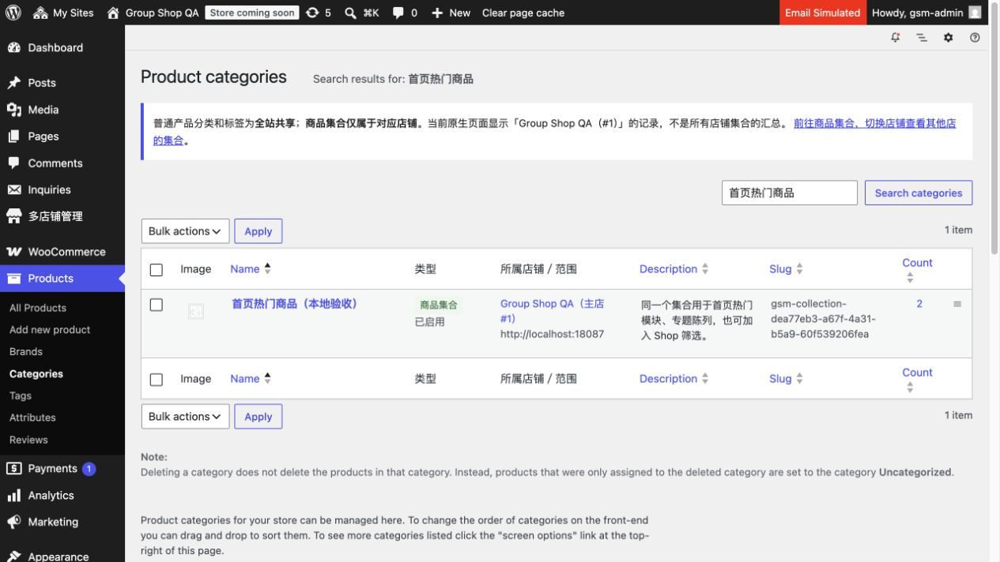

# 0.3.3 原生分类归属提示

日期：2026-11-04，Asia/Taipei。仅本机 localhost:18087 合成 QA，未连接或发布生产。

原生产品分类／标签列表新增类型、所属店铺／范围；普通词条为全站共享，商品集合显示具体店名、编号、地址和状态。原生编辑页也补只读字段和对应集合链接。页面提示当前站点范围，其他店集合经中央入口切换；没有聚合其他店原生表或更改已有权限／写操作。

浏览器实际验证截图所示“首页热门商品（本地验收）”标记为商品集合、Group Shop QA（主店 #1）；点击店名进入该集合编辑页。原生列表在中等宽度优先占满宽度，新增表单保留在下方，避免挤压名称／描述。没有修改业务数据或重建 QA。

[10 项真实只读 HTTP 核对](native-admin-http.json) 通过：列表列、集合所属店、正确管理链接、作用域说明、普通分类共享标记、原生编辑页、标签共享标记、既有子站词表重定向、中央列表及本次临时会话注销。仅对新增显示做适当核对，未重复运行上一轮 154 项写入型集成测试。

新增 PHP 模块和插件入口语法通过；原有商品集合、共享词表和数据结构保持。更新 README、使用、架构、运维、交接及变更记录。

