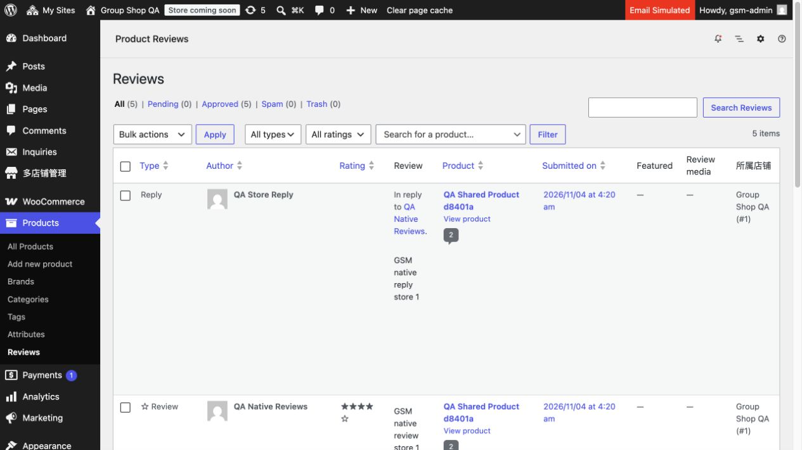
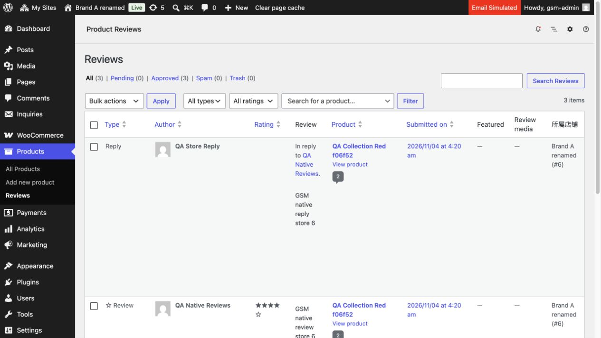

# 0.3.5 评论使用原生 Reviews

日期：2026-11-04，Asia/Taipei。仅本地，未发布；未连接生产。

“独立评论”自建列表、审核表单和 review_status 处理器已移除。原生产品 Reviews 增加“所属店铺”，显示当前店名与 blog_id，评论及回复都适用。原生权限、审核、编辑、回复、评分／商品筛选、批量操作和现有精选／媒体扩展保持；普通 WordPress 评论页面不变。旧链接返回概览，旧请求拒绝。没有新增评论字段、复制／迁移评论或跨店汇总。

## 实际验证

- 三个改动 PHP 文件语法通过。
- [18 项集成](native-reviews.json)：主店／Brand A／Brand B 的评论与回复归属、原评分／审核状态不变、原列保留、普通评论页不扩展、无效行、上下文恢复、退休标签回退及八个标签。
- [32 项真实 HTTP](http-native-reviews.json)：三店原生 Reviews 与店铺列、评论／回复正确归属、匿名登录边界、原生筛选／批量／回复／编辑控件、真实待审及恢复通过、旧审核请求拒绝且不改状态、普通评论页不增列、临时会话注销。
- 浏览器检查主店、Brand A 原生页面，确认“所属店铺”显示 Group Shop QA (#1)／Brand A renamed (#6)。本轮 Brand A 浏览器临时登录已注销，未影响用户主店已有登录。

新增合成评论：主店 #9／回复 #10；Brand A #12／回复 #13；Brand B #6／回复 #7。均在本机既有合成商品上，未导入生产评论或客户资料；HTTP 审核后恢复初始通过状态。没有重跑或重复计入旧版商品／集合／订单套件。

## 当前环境

本轮只读确认已有 QA 已改为 www.main.local 及 www.brand[a/b/c/e/f/g].local，各域名在宿主解析 127.0.0.1；保留现有 Docker project、卷、域名和路由。未执行重建或恢复旧 localhost/.com 配置。HTTP 脚本验证 .qa.env 的 GSM_QA_DOMAIN、固定 QA 目录、允许域名、loopback DNS、HTTP 端口及每次重定向边界，成功完成才写报告。

本次 50 项检查基于当前 .local 环境，可独立于上一轮 localhost 期间报告判断；仍无上线授权。后续客户页收缩待另行需求，无本次评论功能剩余开发事项。

