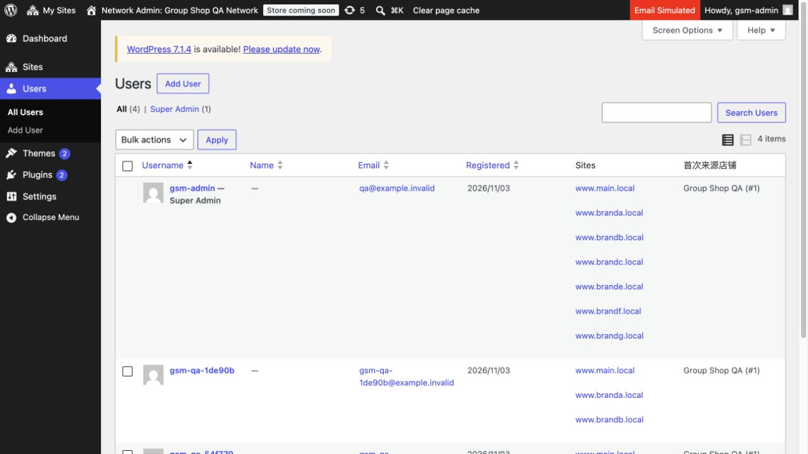

# 0.3.6 用户管理使用原生网络用户

日期：2026-11-04，Asia/Taipei。仅本地，未发布，未连接生产。

删除“共享客户”标签及自建列表，概览“管理原生用户”进入网络用户页。只新增只读“首次来源店铺”，读取现有 _gsm_first_store，按同网络活动店名／编号显示；缺失或非正整数显示未记录，不可用来源保留编号并提示，不猜成主店。复用原生 Sites 当前成员关系、搜索、资料编辑，不将历史访问记录混为成员关系；各店用户列表不扩展。

Customers 原有实现保留：共享用户与默认地址、分店首次登录加入 customer、既有角色保护、来源记录、共享密码范围提示及密码变化后的会话撤销。没有用户／地址迁移、新元数据或业务用户删除。

## 实际验证

- 新增 UserAdmin、Admin、插件入口三个 PHP 文件语法通过。
- [26 项集成](native-users.json)：原生列保留、三店来源解析、只读不写、输出转义、无效／不可用来源、上下文恢复、网络权限、跨店角色／来源／地址与密码变更后的会话撤销、七标签、退休地址和概览入口。
- [22 项真实 HTTP](http-native-users.json)：匿名登录边界、网络用户四个现有合成账户来源／成员／编辑、原生搜索与资料页、主店／分店用户页不加列、Woo 原生地址字段、前台共享说明、七标签与旧地址回退。只读检查，自己的临时逐域会话已注销。
- 浏览器核对网络用户原 Sites 列和新来源列，并确认概览入口与七个标签；保留用户既有浏览器登录，没有修改用户资料或权限。

集成只创建一个临时合成用户，对该用户测试角色、默认地址和密码失效，finally 删除；现有账户密码未改、现有来源未回填。测试报告只记录必要编号、标签和结果，不输出密码／令牌／完整客户资料。本轮不重复统计旧商品／集合／订单／评论套件。

使用现有 www.main.local／www.branda.local 等 .local 隔离域名、group-shop-manager-qa Docker；HTTP 核对 loopback DNS 和跳转白名单，不改宿主路由或重建环境。后续发布仍需用户新通知。

