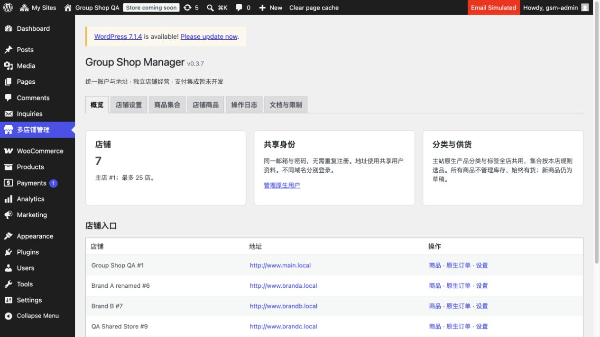

# 0.3.7 移除主商品发布

日期：2026-11-04，Asia/Taipei。仅现有 .local 本机隔离 QA，未连接或部署生产。

按用户要求删除“主商品发布”标签及整个跨店发布功能。旧 tab=catalog 返回概览，catalog_publish 请求即使拥有有效管理员 nonce 也被拒绝。Catalog 的发布 API、字段复制清单、快照／属性转换、媒体导入、商品／变体复制、发布锁和新增映射写入全部移除，没有替代入口。剩余六个标签。

Catalog 本店编辑、上下架、富文本、图片选择、价格及变体校验保留。已有商品、变体、附件及来源元数据、历史映射和审计不删除或迁移；旧映射继续用于此前确认的统一分类／标签归属同步，不复制内容／价格或建立新映射。本轮未解除旧关联商品的分类控制，不修改其他线上店铺。

## 实际验证

- 三个改动 PHP 文件语法通过。
- [25 项集成](retired-publisher.json)：发布方法／清单已删除、本店简单商品／富文本／价格／图片、上下架与旧状态拒绝、变体价格／启用及父价、无效批次不部分保存、无限库存、无映射写入、六标签／旧地址及上下文恢复。
- [17 项真实 HTTP](http-retired-publisher.json)：有效 nonce 的旧发布 POST 拒绝、旧页面回退、富文本／完整标记／媒体控件及授权目标店媒体查询、六个剩余页面和当前帮助说明。临时会话单独注销。
- [15 项数据保留核对](catalog-preservation.json)：七店分别比较商品／变体与附件摘要，加一项全网历史映射摘要；[修改前](catalog-before.json)、[删除后](catalog-after.json)、[最终验收后](catalog-final.json)完全一致，不输出商品原文或客户资料。
- 浏览器实际确认 v0.3.7、六个标签，无主商品发布入口，截图如下。

集成只创建两个临时父商品（简单／可变）及两个变体测试本店保存，finally 删除；图片使用既有本店附件，没有上传或复制。现有商品、变体、附件和映射最终摘要不变。测试正常产生本店编辑审计，不删除历史审计。没有重复计入旧版商品／集合／分类套件。

旧测试以 Catalog::publish 生成 fixture，该 API 已退休；旧 localhost 保护仍不能放宽。当前相关验收使用 retired-publisher.php／catalog-state.php／check-retired-publisher-local.py；以后补回归需另写原生 CRUD 合成 fixture，不能为测试恢复发布功能。线上仍沿用历史 0.2.2，本地未获发布授权。

