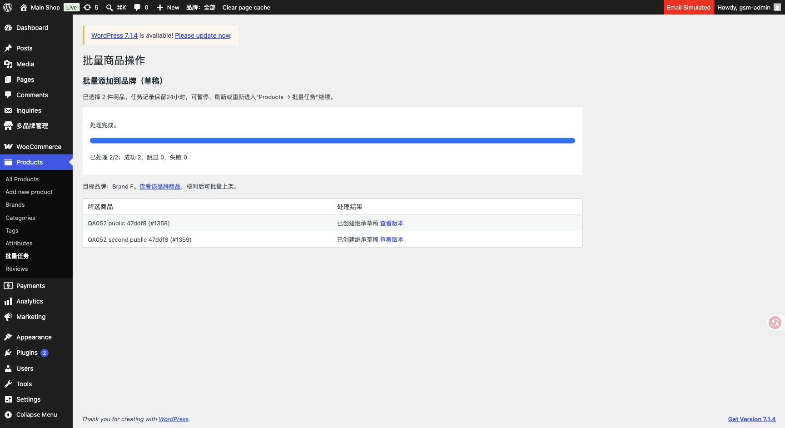

# 0.5.2 本地批量商品验收

2026-11-05，Asia/Taipei。仅本机七个 HTTP .local 门面，原生 WordPress 单站、7品牌；源码0.5.2，生产未连接／未发布。邮件／支付MU拦截保留，无新用户、真实邮件、付款、退款或业务迁移。

## 可用功能

原生 Products 勾选公共商品 → 批量添加到品牌（草稿） → Apply → 确认目标品牌 → 开始。每批最多200个不同父商品，表头选择仅本页，更多商品分批处理或调整Screen Options。目标品牌既有版本（含回收站）跳过，新版本继承、空覆盖、草稿；媒体复用，评论不复制。继承关联仅总管理员可建立。

品牌销售版本可批量上架／转草稿；公共档案和已经达标的记录跳过。选择后状态变化跳过避免覆盖。员工按品牌及对象能力授权。任务单件请求、私有24小时记录、暂停／继续／仅重试失败项，从Products → 批量任务返回最近任务。页面关闭不后台执行，任务到期不删除商品；整批部分失败不回滚成功项。

## 实际验证

- [runtime.json](runtime.json)：22项PHP行为检查；混合结果、已有差异完全保留、幂等、变体写入故障后清理和重试、回收站去重、状态冲突、200上限、员工权限和任务归属。
- [http-bulk-products.json](http-bulk-products.json)：15项真实HTTP检查；原生Apply不写商品、确认／执行nonce、两个并发任务只建一版、暂停／刷新／继续、原生批量上架与草稿、重复批次跳过、员工操作入口与任务归属。
- [browser-checks.json](browser-checks.json)：真实Chrome从Products选择两件公共商品，确认Brand F，JavaScript逐件处理，最终2/2成功、0跳过、0失败，查看版本及目标品牌链接可见。
- [source-integrity.json](source-integrity.json)：清理后718项原迁移资料只读核对通过；原商品字段、订单快照、评论、页面、附件及品牌资料保留。
- 全部67个插件／测试PHP文件语法通过，批量JS及本地Python脚本语法通过，git diff --check通过。

## 测试清理及限制

[cleanup.json](cleanup.json)：最终删除18条QA052临时商品／变体、16个仅涉及fixture的任务；保留114父商品／287商品及变体记录、7品牌，Multisite为false。当前QA052父商品0。验收中修正测试脚本的私密标题前缀判断、员工会话请求域名，并清理中断留下的QA052记录后重新通过完整套件；截图来自上一轮同功能浏览器验收，其临时数据也已清除（cleanup-first-pass.json）。更早中断残留清理29＋11条，均为同名前缀合成fixture；不触碰原始业务资料或保留演示。

现仅支持简单／可变公共商品。捕获创建异常只回收本次部分记录；硬中断可能留下构建标记的草稿，应打开核对并Update后重试。回收站版本须先恢复，重复添加不会覆盖或复制。没有自动全目录后台任务或一键生产迁移，不宣称未知第三方插件兼容。
