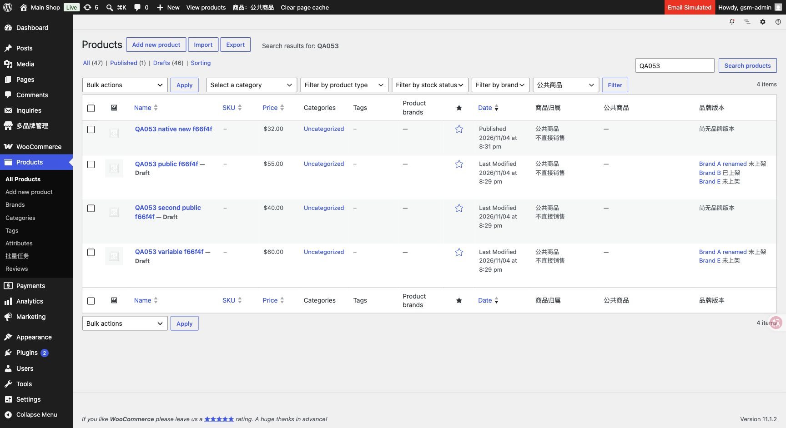
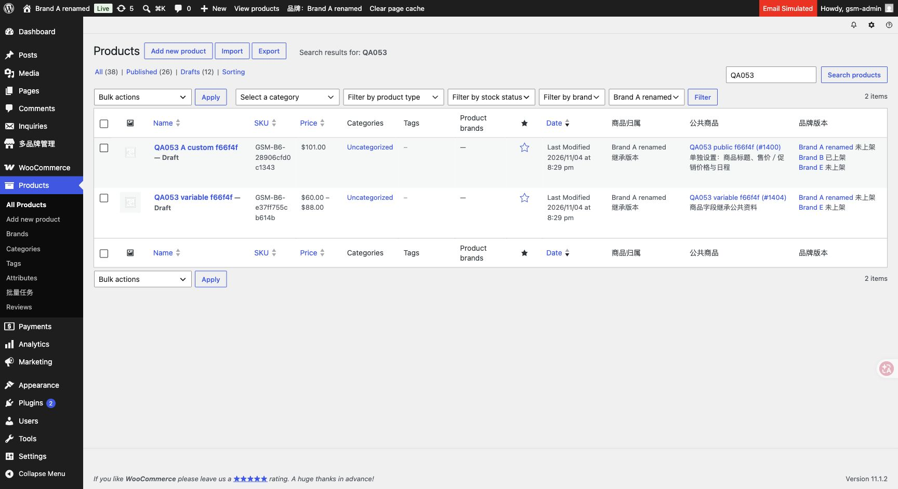

# 0.5.3 统一公共／品牌商品模型

2026-11-05，Asia/Taipei。本地单站、七品牌；源码0.5.3，未部署或连接生产。邮件和支付MU拦截保留。

## 当前行为

取消独立品牌商品，品牌特有商品也先建公共档案，再只为目标品牌建立继承版本。已有五组差异和变体差异、独立发布状态保持。新增公共商品仅总管理员；品牌归属与公共来源固定，不能解除／更换。中央品牌商品标签保留列表及快捷状态，全部编辑统一原生，独立简化编辑器退休。

Products两个自定义筛选合并为公共／某品牌的单一归属选择。总管理员从菜单进入默认公共，不受上次品牌Cookie影响；员工只可选择获授权品牌，没有公共维护权限。状态计数与导航、搜索／分页保持选择。品牌版本列可直达各版本编辑；不再提供全品牌混合列表或独立类型选项。原生Woo Product brands是商品分类词表，与门面归属不同，本轮未改其标准分类功能。

## 验证证据

- [runtime.json](runtime.json)：19项模型、创建能力、固定来源／品牌、复制销售版本拒绝、五组继承／覆盖、变量商品与员工权限、批量继承检查。
- [http-products.json](http-products.json)：17项真实原生列表／表单检查，覆盖默认公共、不沿用Cookie、品牌隔离、状态计数／链接、固定来源、非法提交不部分保存、有效差异保存、新建公共草稿和员工授权边界。
- [cron.json](cron.json)：2项既有公共商品与销售版本的Woo无登录定时保存检查，保留覆盖及关联。合计38项行为检查。
- 浏览器从默认公共目录切换Brand A，分别4条公共fixture与2条品牌继承版本，单一筛选和来源／版本链接可见。
- [source-integrity.json](source-integrity.json)：718项原始迁移资料核对通过，商品字段／变体／订单快照／评论／页面／附件及品牌资料保留。
- 72个插件／测试PHP文件语法、当前JS／Python语法与git diff --check通过。

## 数据影响与清理

[auto-drafts.json](auto-drafts.json)：只有两条未保存auto-draft旧品牌归属改为公共，原元数据私有备份，未改变内容、状态或删除记录。所有已保存品牌商品本来就有关联，无需迁移或新建业务商品。[model-audit.json](model-audit.json)：45公共记录（43有效＋2自动草稿）、71品牌版本、无未关联品牌商品。

[cleanup.json](cleanup.json)：清理16条QA053临时商品／变体及1个fixture任务，QA053父商品0；保留114有效父商品／287商品及变体记录／7品牌，Multisite=false。截图中的测试商品已清除。HTTP验收首次发现WordPress先写标题再调用Woo钩子，新增原生保存前校验后复测通过；修正表单测试排除未点击submit，复测确认公共草稿状态。测试只使用合成fixture，无新用户、真实邮件、支付或生产操作。

旧v051／v052测试的独立商品fixture语义已退休，不直接重跑；当前准备／HTTP／cron／清理顺序见OPERATIONS。未知第三方插件自行SQL写入仍需专项适配，不将受信内部unscoped视为公开授权接口。
