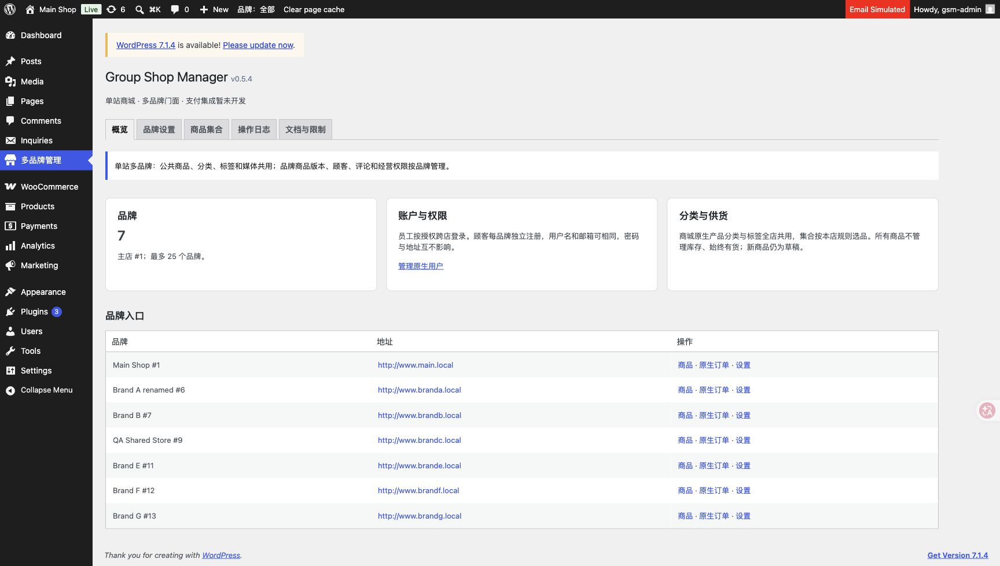

# 0.5.4 退休中央品牌商品页面

2026-11-05，本地源码0.5.4，单站七品牌，未连接／发布生产。

中央只保留概览、品牌设置、商品集合、操作日志、文档与限制五个标签。删除ProductAdmin及仅供中央页面使用的Catalog服务和加载，移除旧商品编辑器脚本；保留集合编辑使用的媒体、富文本和共享布局。原生Products、公共／品牌版本、原生编辑和批量功能保持。

[http-retired-products.json](http-retired-products.json)：11项真实HTTP检查通过，覆盖五标签、概览商品原生链接、旧列表品牌范围、旧无范围进入公共、旧商品编辑跳转、无效或不匹配范围404、旧保存／状态操作410、nonce403及集合页面可访问。旧GET使用当前已登录后台的相对路径安全跳转，避免品牌home域名与后台域名不同导致安全重定向回落。

70个插件及测试PHP文件语法通过，admin.js／原生商品JS与Python脚本语法、git diff --check通过。Chrome实际查看五标签并保存截图；临时浏览器标签已关闭。没有创建测试商品、迁移／删除业务商品或集合，无新增用户、邮件或付款，未运行旧商品fixture套件。

用户追加商品集合合理性评估，已只读检查集合规则、原生成员关系、品牌继承及展示接口；建议保留共享分类与品牌集合的职责区分，方案见plugin/muti-storefront-plugin/docs/COLLECTIONS-ASSESSMENT.md。本轮没有修改集合规则或数据，不将评估视为后续重构授权。
