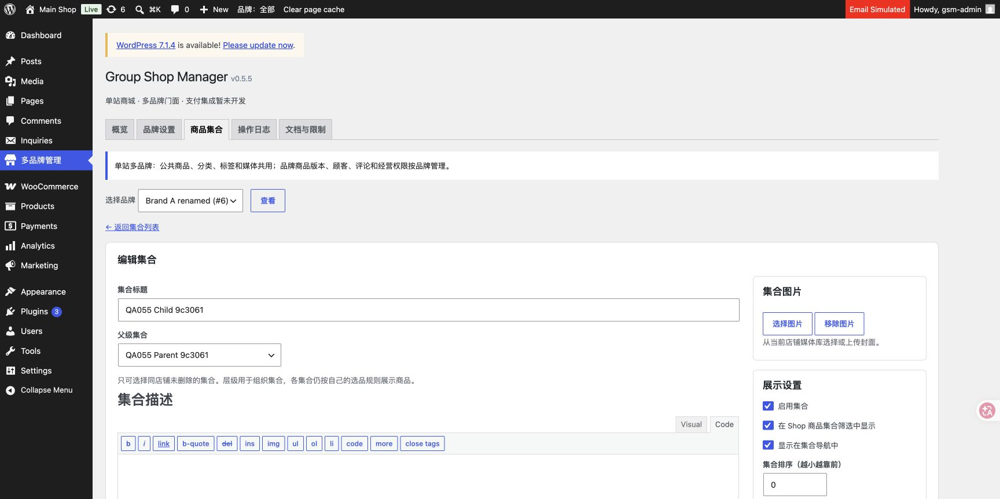

# 0.5.5 分类范围与集合层级（本地）

2026-11-05，Asia/Taipei。本地单站七品牌，源码0.5.5，未连接／部署生产。

原生Products → Categories默认共享分类，不读取上次品牌Cookie；范围选择各店后仅显示所属商品集合。搜索、排序、分页和SQL计数保持范围；集合名称／管理操作进入完整集合编辑器，旧原生编辑地址也跳转。标签页和员工权限保持原边界，中央仍为五标签。

集合编辑支持原生parent多级层级。同品牌、未删除、非自身／子孙由服务端校验，失败表单保留父级；ID与slug保持。列表缩进与父级名称、嵌套导航、动态区块选项、Shop选项及主题数据parent生效。各集合的规则、成员和计数独立，原生归档包含自选排序时也不自动汇总子集合。父级移入回收站不连带删除子集合，原关系留待恢复；编辑子集合时若父级不可用须重新选择。

新建集合写入品牌标记，商品显式选入／排除／置顶检查本品牌销售版本。原生集合快速编辑、直接删除及拖动排序请求拒绝；共享Woo拖动遍历排除集合。共享列表用ID排除避免NOT EXISTS破坏Woo可选排序连接；完整全局层级缓存不随品牌裁切。筛选器插在搜索表单前，不进入Woo通知抽屉。

验证证据：

- [runtime.json](runtime.json)：23项集合创建／多级父级／改父级／slug保持／循环和跨店拒绝／商品归属／继承关系／导航／独立选品／父级回收恢复／员工权限检查。
- [native-runtime.json](native-runtime.json)：11项全局层级缓存、独立品牌集合计数、三范围SQL列表／计数一致、无order元数据共享分类可见、全部集合品牌标记及共享拖动遍历隔离检查。
- [http-taxonomy.json](http-taxonomy.json)：31项真实HTTP，含原生共享默认、A／B切换、完整分页、搜索／排序保留范围、旧编辑链接、真实父级POST、失败重试／nonce及原生快捷写入拒绝；父集合归档默认／价格排序均只显示自己的规则成员。
- [original-data.json](original-data.json)：718项原始迁移资料只读核对通过。
- [cleanup.json](cleanup.json)：5个本轮QA055商品、6个分类／集合词条已清理；原词条ID／名称／slug／parent、原分类标签关系和所有品牌原集合规则与测试前快照完全一致。没有业务资料迁移或批量重设parent。
- [syntax.json](syntax.json)：73个插件／测试PHP、4个JS和1个Python语法通过，git diff --check通过。

Chrome真实浏览器核对共享默认和可见范围选择器、切换Brand A、搜索仍保留品牌、店铺视图隐藏原生新增／快速编辑／拖动入口、点击集合名称进入编辑器、已保存父级选中、完整集合列表多层缩进与父级名称。只使用本地QA055合成资料；临时浏览器标签已关闭，不注销用户原有浏览器会话。截图来自首轮fixture，最终脚本复验创建的随机编号可不同，两轮fixture均已清理。

边界：层级是集合组织关系，不自动继承／汇总子集合规则；原生层级归档URL随parent改变，ID引用和slug保留，本轮不新增旧URL重定向服务。没有独立taxonomy迁移、主题首页自动替换、员工提权、新用户、实际邮件／付款或生产发布。
