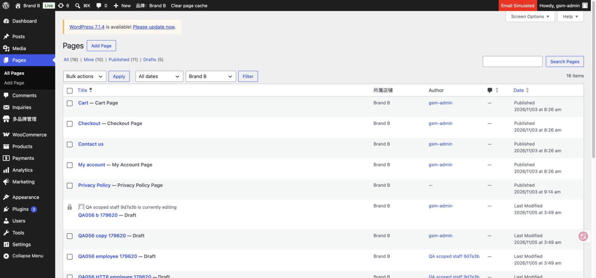
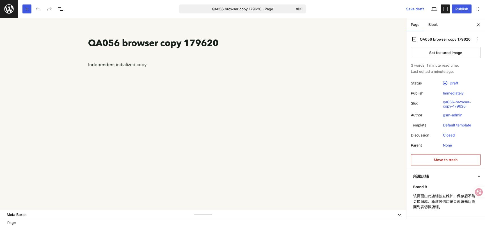

# 0.5.6 原生页面按店铺区分（本地）

2026-11-05，Asia/Taipei。本地单站七品牌，源码0.5.6，未连接／发布生产。

用户最终要求只按店铺区分页面，不需要模板继承。最终实现为NativePages扩展原生Pages列表：所属店铺筛选／列、主店默认、保留范围的新增／编辑／搜索／排序和状态／作者计数。页面继续使用原生区块编辑器，标题、正文、发布状态、修订和同店父级独立。编辑页显示只读归属；服务端在REST和原生CRUD写入前校验，直接元数据不能改店铺，跨店父级与循环关系拒绝。

后台REST请求保持已登录主机并沿用原签名品牌头，解决中央后台切换店铺后跨域Cookie导致Gutenberg不能保存的问题。草稿预览使用当前登录主机＋页面级nonce＋明确品牌管理员授权，不在其他域创建登录会话；匿名／伪造签名不能进入预览，其他店铺路径返回404而非猜测跳转到另一品牌。

没有公共页面模板、模板继承、品牌变量、模板同步或新用途绑定层，相关尝试代码／界面／合成数据均已清理。现有政策页面、原生隐私与Woo条款设置、页脚代码和新店页面初始化沿用原实现；停用旧单店政策自动写入回调，避免按全局slug覆盖独立页面。没有业务数据迁移或自动发布政策正文。

验证证据：

- [runtime.json](runtime.json)：21项运行检查，覆盖独立内容／状态、品牌归属、同店父级、循环／跨店／改归属拒绝、元数据保护、员工权限、新建归属及原生隐私设置保留。
- [http-native-pages.json](http-native-pages.json)：29项真实HTTP，覆盖主店默认、店铺切换／搜索／排序、原生区块REST读写、同店新建、非法请求不部分保存、前台范围和签名草稿预览。员工按既有规则在其授权店铺域名登录，不放宽登录范围。
- [cleanup.json](cleanup.json)：8个本轮合成页面及其原生修订已清理；原页面ID、标题、正文、摘要、状态、parent、内部slug和作者逐项一致，原隐私设置、其他业务配置及七品牌注册表保留。缓存generation／清理时间／原因是允许运行变化的记录。
- [original-data.json](original-data.json)：718项原始业务资料只读核对通过。
- [syntax.json](syntax.json)：76个插件／测试PHP、4个JavaScript和1个Python语法通过，git diff --check通过。

Chrome实际查看主店默认与Brand B切换，确认列表所属店铺列及普通页面编辑器；对QA056合成独立页面修改标题、原生Save draft保存、刷新后核对持久化，所属店铺仍为Brand B。没有页面继承或同步控件，临时浏览器标签已关闭，不注销用户原有浏览器会话。

只改group-shop内本插件及其说明／本地测试；主题页脚无最终代码差异，独立trovesia-shop未修改。现有页面公开路径沿用既有品牌路由，不额外开发改网址重定向、政策模板、自动填充政策或退款业务。
